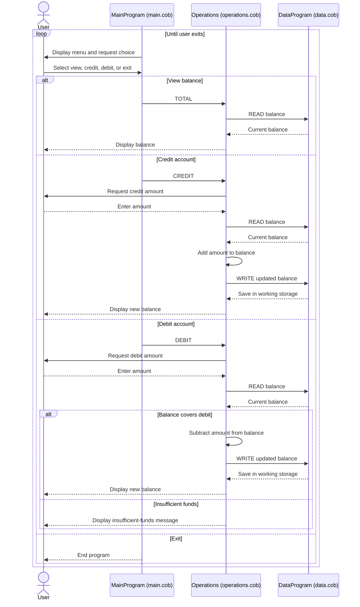

# School Accounting System

This document describes the current COBOL account-management program in the context of a school's accounting system. The application provides a small command-line interface for viewing and changing an account balance.

## Program Files

### `src/cobol/main.cob`

`MainProgram` is the application's entry point and user interface. It displays the account-management menu, reads a menu choice, and calls `Operations` to carry out the selected action:

- `1` calls `Operations` with `TOTAL` to view the balance.
- `2` calls `Operations` with `CREDIT` to add funds.
- `3` calls `Operations` with `DEBIT` to subtract funds.
- `4` exits the menu loop and stops the program.

Any other choice displays an invalid-choice message and returns to the menu.

### `src/cobol/operations.cob`

`Operations` implements the account actions and communicates with `DataProgram` to retrieve or persist the balance.

- For `TOTAL`, it reads the stored balance and displays it.
- For `CREDIT`, it prompts for an amount, reads the balance, adds the amount, writes the result, and displays the new balance.
- For `DEBIT`, it prompts for an amount and reads the balance. It subtracts and writes the result only when the balance is at least the requested amount; otherwise, it displays an insufficient-funds message.

### `src/cobol/data.cob`

`DataProgram` is the balance storage module. Its `STORAGE-BALANCE` field starts at `1000.00`. The operation passed through its linkage interface determines whether it copies the stored value into the caller's balance (`READ`) or saves the caller's balance (`WRITE`). The storage is a working-storage field, so it is held in the running program rather than persisted to a file or database.

## Student Account Business Rules and Current Limits

- The account starts with a balance of `1000.00`.
- A credit increases the balance by the entered amount.
- A debit is allowed only if the current balance is greater than or equal to the entered amount. A rejected debit leaves the balance unchanged.
- The program does not currently identify students or maintain separate balances. All operations use the same single balance, so this is not yet a per-student account ledger.
- There is no durable storage, transaction history, or validation that a credit or debit amount is positive. These behaviors are not implemented by the current COBOL files.

## Data Flow

The menu remains active until the user selects Exit.
